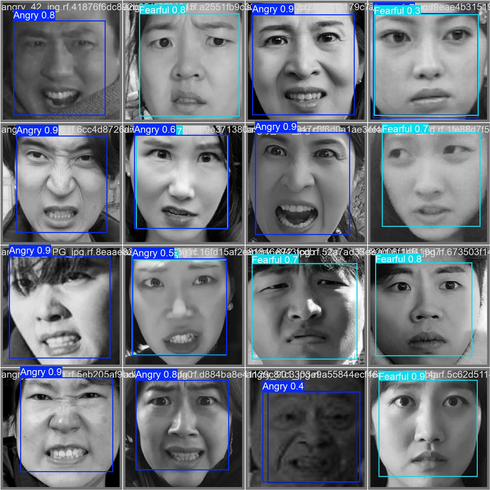

# 情绪识别子模块（YOLOv11 Face Emotion）

> **子模块**：本目录为 YOLOv11 人脸情绪识别独立 demo（`app.py`），是根项目 [AI-Vision-Guardian](../README.md) 情绪识别弹窗的后端训练参考。
>
> 完整项目文档（系统架构、快速开始、TTS 工程要点等）请查阅根目录 [README.md](../README.md)。


## Table of Contents

- [Features](#features)
- [Installation](#installation)
- [Usage](#usage)
- [License](#license)
- [Contributing](#contributing)

## Features

- Real-time face emotion detection.
- Custom-trained YOLOv11 model for improved accuracy.
- Supports detection of five emotion classes.

## Installation

To get started, clone the repository and install the required packages.

```bash
git clone https://github.com/alihassanml/Yolo11-Face-Emotion-Detection.git
cd Yolo11-Face-Emotion-Detection
pip install -r requirements.txt
```

Make sure you have the following dependencies installed:

- Python 3.x
- OpenCV
- Ultralytics YOLO

## Usage

To run the model for face emotion detection, use the following script:

```python
from ultralytics import YOLO
import cv2

# Load the trained model
model = YOLO('best.onnx') 

cap = cv2.VideoCapture(0)

while True:
    ret, frame = cap.read()
    if not ret:
        print("Failed to grab frame.")
        break  

    # Convert the frame to grayscale
    gray_image = cv2.cvtColor(frame, cv2.COLOR_BGR2GRAY)
    
    # Convert grayscale to 3-channel image
    gray_image_3d = cv2.merge([gray_image, gray_image, gray_image]) 
    
    # Perform inference
    results = model(gray_image_3d)
    result = results[0]

    # Plot results
    try:
        annotated_frame = result.plot()
    except AttributeError:
        print("Error: plot() method not available for results.")
        break
    
    # Display the output
    cv2.imshow('YOLO Inference', annotated_frame)
    
    if cv2.waitKey(1) == 27:  # ESC key to exit
        break

cap.release()
cv2.destroyAllWindows()
```

## Visualization

The results are visualized using OpenCV, displaying the detected emotions in real-time.

## License

This project is licensed under the MIT License. See the [LICENSE](LICENSE) file for details.

## Contributing

Contributions are welcome! Please feel free to submit a pull request or open an issue for discussion.

---

Feel free to edit the sections to match your project details better. You can also include screenshots or visualizations in the README for added clarity and engagement!

---

## 优化记录 (2026-11-11)

### 1. GPU 加速配置

**问题**: ONNX Runtime 默认使用 CPU 推理，未启用 CUDA GPU 加速。

**解决方案**:
1. 安装 `onnxruntime-gpu==1.19.0`（兼容 CUDA 12.1 + NumPy 2.x）
2. 安装 NVIDIA CUDA 库：`nvidia-cudnn-cu12`、`nvidia-cublas-cu12`、`nvidia-cuda-nvrtc-cu12`
3. 在 `app.py` 头部自动将 venv 中的 CUDA DLL 路径加入 PATH

**效果**: 推理自动使用 `CUDAExecutionProvider`，RTX 3070 Ti 加速。

### 2. 性能优化

**原始代码问题**:
- 每帧都进行 BGR → Gray → 3通道合并，浪费计算资源
- 无置信度阈值控制，低置信度检测也显示
- 无 FPS 显示，无法评估性能

**优化内容**:
- 跳过灰度转换，直接用彩色 BGR 帧推理
- 添加 `--conf` 参数控制置信度阈值（默认 0.5）
- 添加 FPS 实时显示（30帧滑动平均）
- 支持 `--imgsz` 参数调整推理分辨率（320/416/512/640）

### 3. 功能增强 (方案B)

**新增功能**:

| 功能 | 说明 | 快捷键/参数 |
|------|------|-------------|
| 情绪历史记录 | 每 N 秒统计情绪分布，生成趋势图 | `--history-interval` |
| CSV 日志 | 记录每次检测的时间、情绪、置信度 | `--no-log` 禁用 |
| 录像功能 | 录制检测过程为 MP4 视频 | R 键 |
| 配置文件 | 支持 YAML 配置所有参数 | `--config` |
| 情绪统计面板 | 显示主导情绪和情绪稳定度 | H 键切换 |
| 截图功能 | 保存当前帧到 output/ | S 键 |

**情绪趋势图** (Plotly):
- 渐变填充面积图，展示各情绪随时间变化
- 配色与项目 UI 一致（深色背景 + 强调色）

**文件结构**:
```
qingxu/
├── app.py              # 主程序（功能增强版）
├── config.yaml         # 配置文件示例
├── best.onnx           # YOLOv11 情绪检测模型
├── test_app_v2.py      # 测试脚本
└── output/
    ├── screenshots/    # 截图
    ├── recordings/     # 录像
    ├── logs/           # CSV 日志
    ├── emotion_history.json   # 历史记录
    ├── emotion_trend.png      # 趋势图
    └── emotion_distribution.png # 饼图
```

### 4. 快捷键一览

| 按键 | 功能 |
|------|------|
| R | 开始/停止录像 |
| S | 截图 |
| T | 提高置信度阈值 (+0.05) |
| G | 降低置信度阈值 (-0.05) |
| H | 显示/隐藏历史面板 |
| ESC | 退出 |

### 5. 运行示例

```bash
# 使用默认配置
python qingxu/app.py

# 使用配置文件
python qingxu/app.py --config qingxu/config.yaml

# 禁用日志和录像（节省资源）
python qingxu/app.py --no-log --no-record

# 调整推理分辨率和置信度
python qingxu/app.py --imgsz 416 --conf 0.6
```

### 6. 依赖说明

```
# 核心依赖
ultralytics>=8.4.0      # YOLO 推理
onnxruntime-gpu==1.19.0 # GPU 加速推理
opencv-python>=5.0.0    # 图像处理

# 图表和配置
plotly>=5.0.0           # 情绪趋势图
kaleido>=0.2.1          # Plotly PNG 导出
pyyaml>=6.0             # 配置文件

# NVIDIA CUDA 库 (GPU 加速必需)
nvidia-cudnn-cu12       # cuDNN
nvidia-cublas-cu12      # cuBLAS
nvidia-cuda-nvrtc-cu12  # CUDA NVRTC
```

### 7. 兼容性

- ✅ 不影响 `deidao` 模块的跌倒检测（PyTorch 推理）
- ✅ `deidao` 的情绪检测弹窗复用 `best.onnx`，自动继承 GPU 加速
- ✅ 所有新功能可通过参数关闭，保持向后兼容
- ✅ Windows 中文编码问题已处理（PYTHONIOENCODING=utf-8）
